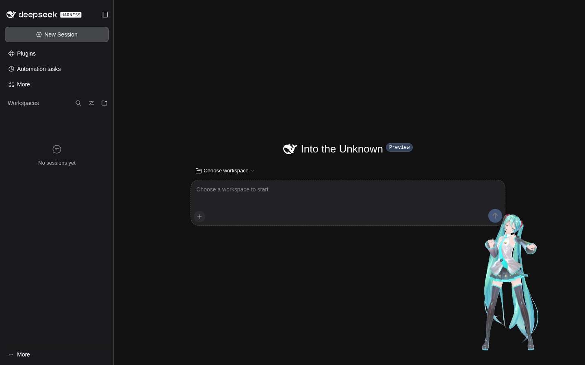

# dsh-miku

A DeepSeek Harness web client plugin with a dancing Miku.



## Installation

In DeepSeek Harness open **Plugins**, click **Add plugin** and paste the
repository address:

```text
https://github.com/anysda/dsh-miku
```

## License

The code is under the [PolyForm Strict License 1.0.0](LICENSE): personal,
non-commercial use, no redistribution and no derived works. The model is YYB
Miku by SANMUYYB, Zero and Marie MMD; its terms are in the ReadMe next to it.
